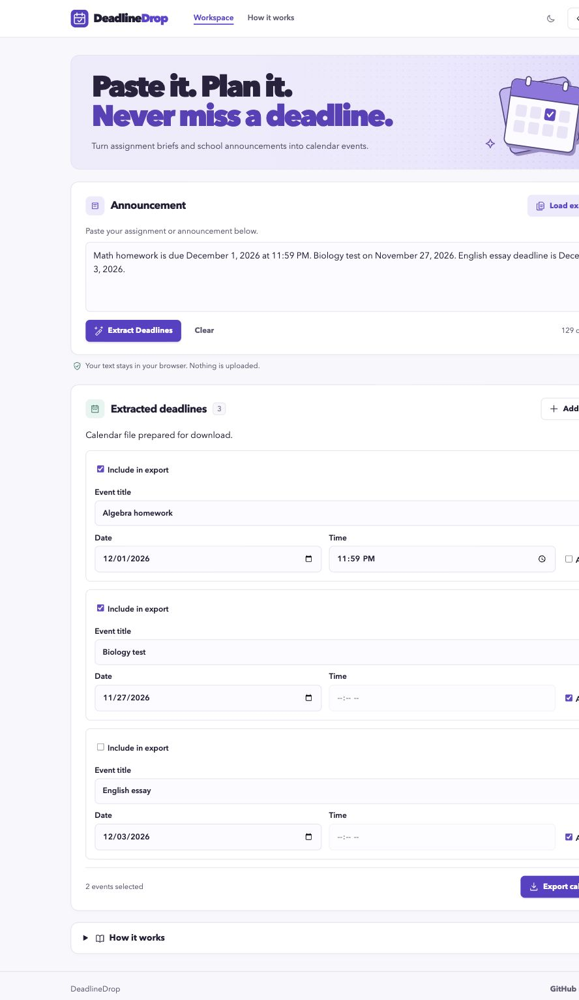

# DeadlineDrop Beta

**Paste it. Plan it. Never miss a deadline.**

Turn an assignment announcement into editable calendar events in your browser. Download the selected deadlines together and import the file into Google Calendar, Apple Calendar, or Outlook.

**Beta 1 · v1.0.0-beta.1** — Please review extracted dates before importing. Feedback on parsing and calendar imports is welcome through the repository’s issue templates.

**Live demo** — [Open DeadlineDrop Beta](https://howardjiangj.github.io/DeadlineDrop/)  
**GitHub repository** — [HowardJiangj/DeadlineDrop](https://github.com/HowardJiangj/DeadlineDrop)

## Screenshot



## Run locally

Download or clone the repository. From its root, run the following on Node.js 20 or later. The app has no package dependencies or compilation step.

```sh
npm start
```

Open **http://127.0.0.1:4173**. Set the PORT environment variable to choose another port. Alternatively, serve the site directory with any static HTTP server. Use localhost or HTTPS for browser-generated event IDs.

## How it works

1. Paste English text or choose **Load example**, then **Extract Deadlines**.
2. Check each title, date and time. Correct highlighted fields, confirm inferred years and add any missing events. Extracting again appends new events. Clear empties the announcement field.
3. Select the cards you want, then choose **Export calendar**. Import the downloaded file using your calendar app's file import command.

The interface includes light and dark themes, manual event creation, duplicate detection, and validation before export.

## Supported dates and examples

| Announcement | Result |
| --- | --- |
| Math homework is due December 1, 2026 at 11:59 PM. | Math homework, Dec 1 at 23:59 |
| Biology test on Nov 27, 2026. | Biology test, all day |
| Submit portfolio by 2026-12-15. | Portfolio, all day |
| Studio exam on 12/15/2026 at 09:30. | Studio exam, Dec 15 at 09:30 |
| Essay deadline is December 3. | Next December 3, with the inferred year shown |
| Exam on 12/01/2026. | Date left blank for review because both month/day orders are possible |

Use one title and date per sentence, line, or semicolon-separated clause. Simple dated clauses joined by “and” or “then” also work. Month names may be abbreviated, and ordinal days such as “Dec. 1st” are supported.

A missing year means the next valid occurrence on or after the browser's local date. February 29 advances to a leap year. Explicit past dates keep their year and display a warning. Slash dates use month/day only when the order is clear. Two-digit years, relative dates, date ranges, recurrences, and named time zones need manual review. Complex prose can omit or combine events. Review the original announcement before exporting.

## Calendar format and time zones

Timed deadlines use floating local wall time. A 09:30 deadline is serialized as 09:30 without a UTC suffix or time-zone identifier. The importing calendar interprets that value in its local context, including its treatment of repeated or skipped daylight-saving hours. Confirm the destination zone when sharing across time zones. Only the file creation timestamp uses UTC.

All-day events use a date-only DTSTART and last one day. Timed deadlines indicate a point in time. Each card keeps its UID across repeated exports in the same session. Titles escape backslashes, commas, semicolons and newlines. Lines end with CRLF and fold at 75 UTF-8 octets. See [RFC 5545](https://www.rfc-editor.org/rfc/rfc5545).

## Privacy

Your text stays in your browser. Nothing is uploaded. The site serves its own scripts, icons, and styles. Announcements and cards stay in memory and disappear on reload. Only the theme preference uses local storage. Export creates a local file. Importing that file into a cloud calendar is a separate action you control.

## Tests

```sh
npm test
```

The built-in Node test runner covers extraction, inference, ambiguity, validation, duplicate events, calendar escaping, folding, and daylight-saving boundary dates. CI repeats the suite in UTC, America/Chicago and Pacific/Auckland.

## Project layout

```text
site/
  index.html, style.css, favicon.svg
  js/
    app.js           Controls, cards, feedback and downloads
    parser.js        English date and title extraction
    calendar.js      iCalendar serialization
    utils.js         Shared event model and validation
tests/               Automated regression tests
docs/                Workspace screenshot
.github/             Issue templates and test/deploy workflow
dev-server.js        Local static preview
```

## Publish on GitHub Pages

1. Create a GitHub repository you can administer. Push the project files, including the .github directory, to its main branch.
2. In **Settings → Pages → Build and deployment**, select **GitHub Actions** as the source.
3. Open **Actions → Test and deploy → Run workflow** and select main. Subsequent pushes to main run it automatically. Tests must pass before the workflow uploads the site directory and deploys it.
4. Open the deployment URL shown in the github-pages environment. Update the project links at the top of this README if publishing a fork. The workflow inserts the actual repository URL into the deployed interface.

Pull requests run the tests. Deployment uses the repository's built-in Actions token. See [GitHub's custom workflow guide](https://docs.github.com/en/pages/getting-started-with-github-pages/using-custom-workflows-with-github-pages).

## Contributing and license

Use the issue templates to report a reproducible example or suggest a feature. See [CONTRIBUTING.md](CONTRIBUTING.md) for local checks and pull request guidance. DeadlineDrop is available under the [MIT License](LICENSE).

Suggested GitHub topics include javascript, calendar, icalendar, productivity, student-tools, deadline-tracker, open-source, and privacy.
